  

  
  
  
  

## About me

I'm a **Senior Consultant at [StatusNeo](https://statusneo.com)**, working on **Generative AI and Agentic AI**. I design LLM agents that plan, call tools, retrieve and check evidence, and I ship them as secure, observable, production-grade systems.

Underneath is **5+ years of backend engineering** (Python, FastAPI, Django, Kafka, AWS, Azure), so the agents I build come with real software around them: typed APIs, async workers, event streams, tests and guardrails.

- **Agentic AI** — LangGraph multi-agent workflows: routing, tool calling, self-correction loops, human-in-the-loop review, durable Postgres checkpoints
- **RAG → GraphRAG** — hybrid vector + knowledge-graph retrieval (Neo4j, Elasticsearch, ChromaDB), evidence grading, answers with citations
- **Trustworthy AI** — prompt-injection defence, validated structured outputs, guardrails, and agents that abstain when the evidence is weak
- **AI-native backends** — event-driven systems serving **1,000+ concurrent submissions at sub-200 ms**; **~35% less DB connection overhead** with PgBouncer pooling

## More GenAI work

<table>
  <tr>
    <td colspan="2" valign="top">
      <h3><a href="https://github.com/MohdSakib535/Agentic-GraphRAG-Intelligent-Knowledge-Graph-Assistant">Agentic GraphRAG — Intelligent Knowledge Graph Assistant</a></h3>
      
Enterprise knowledge assistant that turns PDF, DOCX, TXT and Markdown into a <b>Neo4j knowledge graph + vector index</b>. A <b>LangGraph agent</b> routes each question to vector, multi-hop graph or hybrid retrieval, grades the evidence, rewrites weak queries, and verifies that every answer is grounded and cited — or abstains when the evidence isn't there.

      LangGraph · LangChain · Neo4j · FastAPI · Celery · PostgreSQL · Redis · Streamlit · Docker
    </td>
  </tr>
  <tr>
    <td width="50%" valign="top">
      <h3><a href="https://github.com/MohdSakib535/SkillProof-AI">SkillProof-AI</a></h3>
      
Multi-agent resume ↔ job-description verifier. A 4-node <b>LangGraph</b> pipeline (extract → match → quiz → evaluate) scores fit, quizzes the skills the job needs, and separates <i>verified</i> skills from merely claimed ones.

      LangGraph · FastAPI · Celery · Kafka + Debezium CDC · Elasticsearch · 8 Docker services
    </td>
    <td width="50%" valign="top">
      <h3><a href="https://github.com/MohdSakib535/data-quality-agent">data-quality-agent</a></h3>
      
AI data-cleaning agent with a human in the loop: deterministic cleaning first, ambiguous text to a <b>local LLM</b> with Pydantic-validated output; low-confidence fixes go to a review queue and every decision is audit-logged.

      FastAPI · LangChain · Ollama · Pydantic · Pandas
    </td>
  </tr>
  <tr>
    <td width="50%" valign="top">
      <h3><a href="https://github.com/MohdSakib535/rag-fastApi-project">rag-fastApi-project</a></h3>
      
Source-grounded <b>RAG Q&amp;A</b> over PDF, DOCX, TXT and YouTube transcripts: chunking + embeddings in ChromaDB, prompt-injection hardening, decoupled FastAPI + Streamlit.

      LangChain · LlamaIndex · ChromaDB · FastAPI · Streamlit
    </td>
    <td width="50%" valign="top">
      <h3><a href="https://github.com/MohdSakib535/FastApi_WebRTC">FastApi_WebRTC</a></h3>
      
AI meeting assistant: WebRTC video rooms stream live speech-to-text into Postgres, then an LLM (OpenAI or Hugging Face) turns the transcript into a downloadable <b>PDF summary</b>.

      FastAPI · WebRTC · PostgreSQL · OpenAI · Hugging Face
    </td>
  </tr>
</table>

[All repositories →](https://github.com/MohdSakib535?tab=repositories)

## Toolbox

**Agentic AI & LLMs**

  
  
  
  
  
  
  
  
  
  

**Engineering & Cloud**

  

Also: Celery · Debezium (CDC) · DuckDB · MySQL · SQLite · Go · JavaScript · Pytest · CloudWatch · Postman · Swagger

## Experience

| Role | Company | Period |
| :-- | :-- | :-- |
| **Senior Consultant** — GenAI & Agentic AI | [StatusNeo](https://statusneo.com) | Sep 2026 – Present |
| **Software Engineer** — Python Backend & GenAI | Kellton | Jun 2025 – Sep 2026 |
| **Backend Developer** | Spacepe | May 2024 – Jun 2025 |
| **Associate Consultant** — Development | Oodles Technologies | Dec 2023 – Apr 2024 |
| **Full Stack Software Developer** | Seo Digital India | Jan 2022 – Nov 2023 |

**B.Tech, Computer Science & Engineering** — Jawaharlal Nehru Technological University, Hyderabad

## GitHub activity

  

## Let's talk

Always happy to compare notes on **agentic architectures, GraphRAG, LLM evaluation and production GenAI**. Find me on [LinkedIn](https://www.linkedin.com/in/mohdsakibb/) or at **mohdsakib9398@gmail.com**.

Building AI agents that plan, retrieve and verify — and know when to say “I don't know.”

